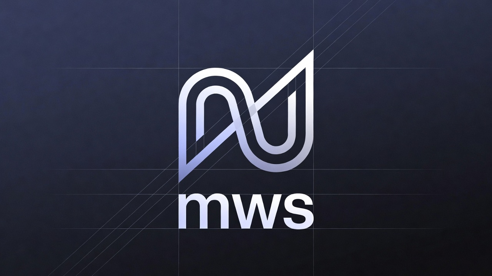

<div align="center">
  
</div>

## What Is mws?

A small Go CLI for managing **meta workspaces** -- a directory layout that wraps one or more native git repos with a shared AI-harness layer and cheap parallel working copies.

1. `mws init my-project` creates a meta workspace: a git repo at the root with the harness under `.mws/` and a first working copy at `main/`.
2. `mws add-repo <url>` registers a native repo and clones it into every working copy.
3. `mws clone <peer>` spins up another working copy that shares the same harness via symlinks, with its own independent native git clones inside.

The result: parallel agents work side-by-side without fighting over the same `.git/`, and changes to the shared harness propagate via symlinks instead of branch syncs.

## Prerequisites

- [Git](https://git-scm.com/) -- the meta workspace and every native repo are git repositories.

## Install

### Homebrew (macOS, Linux)

```bash
brew install sustinbebustin/tap/mws
```

### Pre-built binary

Download the archive for your OS and architecture from the [latest release](https://github.com/sustinbebustin/mws/releases/latest), extract it, and drop `mws` somewhere on your `PATH`. Releases include binaries for darwin and linux on amd64 and arm64, plus a `checksums.txt`.

### Go install

Requires [Go](https://go.dev/) 1.21+ (newer Go toolchain auto-fetched via `GOTOOLCHAIN=auto`).

```bash
go install github.com/sustinbebustin/mws/cmd/mws@latest
```

The harness skeleton ships embedded in the binary -- no separate template repo, no network at `init` time. Run `mws version` to verify the install.

### Shell integration (optional)

With a small shell function installed, `mws clone <name>` cds your shell into the new working copy on success. Without it, `mws clone` prints the new working copy's path as its last stdout line for you to `cd` into -- a child process can't change its parent shell's directory.

```bash
eval "$(mws shell-init zsh)"     # add to ~/.zshrc
eval "$(mws shell-init bash)"    # add to ~/.bashrc
mws shell-init fish | source     # add to ~/.config/fish/config.fish
```

The wrapper only intercepts `mws clone`; every other subcommand is a pure passthrough. See [docs/adr/0008-shell-integration-for-auto-cd.md](docs/adr/0008-shell-integration-for-auto-cd.md) for the design.

### Agent skill (optional)

[`skills/mws`](skills/mws/SKILL.md) teaches coding agents to drive mws headless. Copy it to `~/.claude/skills/mws`, or run `bunx skills add sustinbebustin/mws`.

## Quick start

1. Create a meta workspace.

```bash
cd ~/dev
mws init my-project
cd my-project
```

2. Register one or more native repos. Each one is cloned into every working copy.

```bash
mws add-repo git@github.com:org/frontend.git
mws add-repo git@github.com:org/backend.git
```

3. Spin up a peer working copy alongside `main/` for parallel work.

```bash
mws clone feature-x
```

Optionally register repos you only need in some copies, then pull them in on demand:

```bash
mws add-repo --optional git@github.com:org/worker.git   # register, don't clone
mws clone feature-y --with worker                        # include at clone time
mws include worker feature-x                             # add to an existing copy
```

4. See what working copies exist.

```bash
mws ls
```

## Layout

```
my-project/                       # this directory IS a git repo (meta root)
├── .gitignore                    # allowlist
├── CLAUDE.md                     # mws workspace notes, loaded from every working copy by walk-up
├── .mws.toml                     # Project name, native repos, env mappings
├── .mws/                         # Harness; every entry symlinks into every working copy
│   ├── CLAUDE.md
│   ├── .claude/
│   ├── .workspace/
│   └── justfile
├── .envs/                        # Env-file staging, per repo (untracked)
├── .trash/                       # Working copies removed by `mws rm` (untracked)
├── main/                         # First working copy (untracked)
│   ├── frontend/                 # Independent native git clone
│   ├── backend/                  # Independent native git clone
│   ├── CLAUDE.md -> ../.mws/CLAUDE.md
│   ├── .claude/   -> ../.mws/.claude/
│   └── ...
└── feature-x/                    # Additional working copy
    ├── frontend/                 # Independent clone (own .git/)
    ├── .wt/                      # Worktrees of this copy (untracked)
    │   └── 04/                   # `mws wt new 04`: frontend/ + backend/ on wt/04, harness links
    └── ...
```

Every top-level entry under `.mws/` is symlinked into each working copy -- discovered dynamically, no hardcoded list. New files created directly in a working copy stay local until `mws promote <path>` moves them into `.mws/` and backfills the symlink across every peer.

Working copies can optionally be grouped under a single subdirectory by setting `working_copies_dir` in `.mws.toml` (e.g. `working_copies_dir = "copies"`); subsequent `mws clone`s land at `<meta>/copies/<name>/` instead of `<meta>/<name>/`. See [`docs/config.md`](./docs/config.md) for the rules and caveats.

`mws rm` moves a working copy into `.trash/` rather than deleting it, so a mistaken removal costs nothing: `mws restore <copy>` puts it back with its uncommitted work and env files intact. Trashed copies are purged automatically once they pass the retention window (7 days by default, configurable via `[trash]`). Note that the sweep is opportunistic -- it runs when an mws command touches the trash, not on a timer.

For parallel agents inside one working copy, `mws wt new <name>` creates a **worktree** at `<copy>/.wt/<name>/`: a `git worktree` of every native repo on `wt/<name>`, the same harness symlinks, the copy's ports, env and MCP files, and setup run. `mws wt rm` refuses to lose uncommitted work or unmerged commits. The skeleton wires Claude Code's `WorktreeCreate`, `WorktreeRemove` and `SubagentStop` hooks to `mws wt hook ...`, so `claude -w` and `isolation: "worktree"` subagents use the same layout. See [`docs/config.md`](./docs/config.md#worktrees) and [ADR-0011](./docs/adr/0011-worktrees-are-children-of-a-working-copy.md).

## Commands

| Command | What it does |
|---|---|
| `mws init [name]` | Create a new meta workspace with a first working copy at `<name>/main/` and print its path. Prompts for anything not given; `--description`, `--copies-dir`, `--parent`, `--repo <url>` / `--repo <folder>=<url>` (repeatable) and `--yes` make it non-interactive. |
| `mws add-repo <url> [folder]` | Register a native repo in `.mws.toml` and clone it into every working copy. With `--optional`, register it under `[[optional_repos]]` without cloning anywhere. Re-running with the same URL fills in copies that lack it. |
| `mws clone <name>` | Create a new working copy and print its path. Native repos are freshly cloned from each configured URL and checked out on the default branch. When optional repos exist, prompts to include them; `--with <folder>` (repeatable) or `--no-optional` decides without prompting. Re-running for an existing copy clones only the repos it lacks and prints its path. |
| `mws include <folder> [copy]` | Clone a registered optional repo into a working copy (the current one by default). |
| `mws promote <path>` | Move a top-level file or directory from the current working copy into `.mws/`, symlink it back, and backfill the symlink into every other working copy. |
| `mws ls` | List working copies in the current meta workspace; `--json`. |
| `mws rm <copy>` | Remove a working copy. Confirms first (`--yes` skips), then moves it to `.trash/` so it can be brought back; `--purge` deletes outright, `--dry-run` previews. |
| `mws restore [copy]` | Bring a trashed working copy back and repair its harness symlinks. `--as <newname>` restores under a different name. |
| `mws trash [ls\|prune\|empty]` | Inspect the trash, purge entries past their retention window, or empty it completely; `prune` and `empty` take `--dry-run`. `--json` on all three (`prune` and `empty` list the purged entries). |
| `mws relink` | Refresh harness symlinks across every working copy. Diverged content is asked about, or settled by `--prefer copy\|harness\|skip`; `--dry-run` previews. |
| `mws sync-env [copy]` | Copy staged env files from `.envs/` into a working copy (overwrites). |
| `mws stage-env [copy]` | Inverse of `sync-env`: capture a working copy's env files into staging as the new default. |
| `mws worktree` (`mws wt`) `new\|ls\|path\|exec\|rm\|prune` | Manage worktrees of the current working copy: `new <name>` creates one and prints its path, `ls [--all]` shows branches, dirty state and liveness, `path <name>` prints its path, `exec <name> -- <cmd>` runs in it, `rm <name>...` removes (refuses to lose work; `--force` discards uncommitted files, unreachable detached commits and changed root files; `--dry-run` previews), `prune` removes every clean, idle, merged one. `--json` everywhere. |

### Scripting and agents

Every command runs without prompts when given its arguments and flags, and `mws <command> --help` shows examples. Without a terminal on stdin mws never prompts: a missing input fails with exit `2` and the invocation that supplies it, and a confirmation needs `--yes`. Results go to stdout (paths, lists, `--json`), progress to stderr, so `cd "$(mws clone feature-x --no-optional --setup | tail -n1)"` works. Every `--dry-run` prints one `would <verb> <object>` line per planned change on stdout and nothing else there; under `--json` the same list sits inside `{"dry_run": true, ...}`. Exit codes: `0` ok, `1` failure, `2` usage, `3` refused by a safety check, `4` not found. Re-running a command that half-succeeded finishes it, and removing something already gone exits `4` with a message saying so. See [ADR-0012](./docs/adr/0012-headless-cli-contract.md).

Output is coloured only when the stream is a terminal, and colour is the only difference: piped output carries the same text, `--json` is untouched, and `NO_COLOR` is respected. See [ADR-0013](./docs/adr/0013-colour-on-a-terminal-only.md).

## Configuration

The meta workspace's `.mws.toml` lists the native repos, optional env-file mappings, and optional setup commands. `mws clone` reads it to know what to clone, copy, and run.

```toml
project_name = "my-project"

[[repos]]
  folder = "frontend"
  url    = "git@github.com:org/frontend.git"

  [[repos.envs]]
    source = "apps-internal.env"      # staged at .envs/frontend/apps-internal.env
    target = "apps/internal/.env"     # copied here inside the clone

  [[repos.setup]]
    cmd = "pnpm install --frozen-lockfile"
  [[repos.setup]]
    cmd = "pnpm build"
```

On `mws clone`:

- **Env files** are copied (not symlinked) into the new working copy at their target paths, so peers can hold different ports or service keys. `.envs/` is allowlist-gitignored -- secrets stay local. `mws sync-env` re-pushes staged defaults; `mws stage-env` captures the current working copy back into staging.
- **Setup commands** run via `sh -c` from the cloned repo's directory after env-copy completes. You are prompted before any run; `--setup` skips the prompt, `--no-setup` skips execution. Without a terminal one of the two is required.

Full schema and rationale: [`docs/config.md`](./docs/config.md).

## Development

```bash
go build ./...
go test ./...
go install ./cmd/mws
```

The skeleton lives at [`skeleton/`](./skeleton). Edits there ship in the next binary build.
